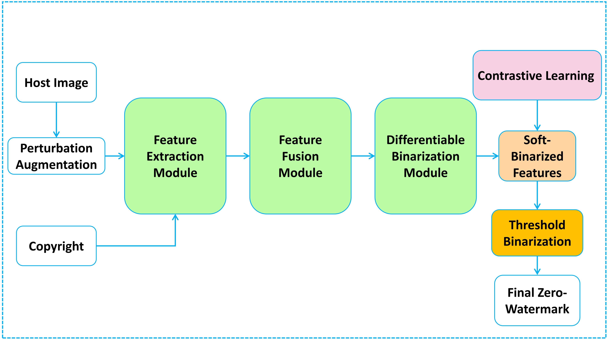

# ConZWNet-V2

This repository contains the implementation of **ConZWNet-V2**, a pipeline-wide contrastive learning framework for robust and discriminative image zero-watermarking.

## 📄 Paper

**Title:**  
**ConZWNet-V2: Going Beyond Intermediate Features with Contrastive Learning over the Complete Zero-Watermarking Pipeline**

**Authors:**  
Deyu Tong, Weilong Kong, Bingdao Huang, Yifan Liu, Na Ren

**Status:**  
Manuscript under review. The final publication link and BibTeX entry will be added after publication.

### Abstract

Zero-watermarking protects image copyright without modifying the host image. ConZWNet-V2 addresses a structural limitation of existing deep learning-based zero-watermarking methods: the training objective is commonly applied to intermediate representations, while downstream feature fusion and binarization remain outside the optimization target. ConZWNet-V2 instead applies contrastive learning directly to the final soft-binarized zero-watermark representation, jointly optimizing feature extraction, feature fusion, and differentiable binarization. The framework consists of ResNet-50 feature extraction, iAFF feature fusion, Sigmoid-based differentiable binarization, and MoCo-V2-based contrastive learning.

---

## 1. Introduction

ConZWNet-V2 is designed around a simple observation: the representation optimized during training should be closely aligned with the representation that ultimately determines the deployed zero-watermark.

The framework therefore applies the InfoNCE objective directly to the **final L2-normalized soft-binarized watermark representation**, rather than to an isolated intermediate backbone feature.

<p align="center">
  
</p>

<p align="center">
  <b>Overview of the proposed ConZWNet-V2 framework.</b>
</p>

The complete pipeline contains four stages:

1. **ResNet-50 feature extraction**
   - Host and copyright images are processed by the ResNet-50-based feature extractor.
   - Stage-4 feature maps are projected from 2048 channels to 768 channels through a 1×1 convolution followed by batch normalization.

2. **iAFF feature fusion**
   - Host and copyright features are fused using Iterative Attentional Feature Fusion (iAFF).
   - Two rounds of MS-CAM-based attention refine the heterogeneous feature streams.

3. **Sigmoid-based differentiable binarization**
   - Global average pooling and a two-layer MLP produce a 1024-dimensional logit vector.
   - Sigmoid produces the continuous pre-normalization representation `v_soft`.
   - The L2-normalized soft-binarized representation is used for contrastive learning.
   - During zero-watermark generation, `v_soft` is thresholded at `0.5` to obtain 1024 binary bits.

4. **MoCo-V2 contrastive learning**
   - Two independently augmented views of the same host image, combined with the same copyright image, form a positive pair.
   - A momentum-updated key encoder and dynamic queue provide a large and temporally consistent negative sample pool.
   - InfoNCE is applied directly to the final soft-binarized representation.

### Main contributions and findings

- **Pipeline-wide contrastive optimization:** the contrastive objective is applied directly to the final soft-binarized zero-watermark representation, allowing supervision to propagate through feature extraction, fusion, and differentiable binarization.
- **Differentiable binarization bridge:** a Sigmoid-based bridge enables gradient propagation through the binarization stage while retaining fixed-threshold discrete watermark generation during inference.
- **Empirical findings from ablation studies:** Sigmoid achieves higher robustness than the evaluated Tanh and STE alternatives, while ResNet-50 provides the most favorable overall robustness–discriminability balance among the evaluated backbones under the present setting.

> The current implementation uses standard **MoCo-V2 / InfoNCE**. The deprecated B-NCE implementation is not included.

---

## 2. Requirements

Key dependencies are listed in `requirements.txt`.

Typical dependencies include:

- PyTorch
- torchvision
- timm
- NumPy
- Pillow
- OpenCV
- tqdm
- matplotlib

Install them with:

```bash
pip install -r requirements.txt
```

A CUDA-capable GPU is strongly recommended for training.

For exact environment reproduction, an exported Conda environment snapshot can also be provided as:

```text
environment_conda.txt
```

It can be recreated with:

```bash
conda create --name conzwnet_v2 --file environment_conda.txt
```

The experiments reported in the manuscript were conducted on a modified NVIDIA GeForce RTX 4090 GPU with 48 GB VRAM.

---

## 3. Dataset

### Host images

The primary experiments use **MiniImageNet** as the host-image dataset:

- Training: **38,400** images
- Validation: **9,600** images
- Test: **12,000** images
- Total: **60,000** images

Dataset link:  
https://aistudio.baidu.com/datasetdetail/167270

During training, the first **1,024 validation images** are used for epoch-level monitoring. Final robustness and discriminability evaluations use the independent MiniImageNet test set.

### Cross-dataset evaluation

Cross-dataset generalization is evaluated on the **COCO val2017** dataset without additional training or fine-tuning.

Dataset link:  
https://aistudio.baidu.com/datasetdetail/103635

### Copyright images

The manuscript uses **200 university-logo images** collected from publicly accessible Internet sources, with one logo retained for each distinct university.

All 200 copyright images are used during both training and evaluation.

Dataset link:  
https://drive.google.com/drive/folders/1lXW2yw7SLmIYmJjYYshk6qLQ9xSc6kAV

### Expected directory structure

```text
Conzwnet-v2/
├── Mini-ImageNet-Dataset/
│   ├── train/
│   ├── val/
│   └── test/
├── copyright/
│   ├── image_001.png
│   ├── image_002.png
│   └── ...
├── results/
│   ├── seed_41/
│   ├── seed_42/
│   ├── ...
│   └── seed_50/
├── train.py
├── evaluate_robustness.py
├── evaluate_discriminability.py
├── modules/
└── utils/
```

The host-image folders are scanned recursively, so class subdirectories are supported.

The dataset roots can also be overridden through environment variables:

```bash
export MINI_IMAGENET_ROOT=/path/to/Mini-ImageNet-Dataset
export COPYRIGHT_ROOT=/path/to/copyright
python train.py
```

---

## 4. Train the ConZWNet-V2 Model

Run:

```bash
python train.py
```

### Training configuration

| Hyperparameter | Value |
|---|---:|
| Image size | 224 |
| Batch size | 96 |
| Epochs | 140 |
| Optimizer | SGD |
| Learning rate | 1e-4 |
| Momentum | 0.9 |
| Weight decay | 1e-4 |
| Watermark dimension | 1024 |
| MoCo queue size | 4096 |
| MoCo momentum | 0.999 |
| Temperature | 0.07 |
| Arnold iterations | 10 |
| AMP | Enabled |
| Default public-script seed | 42 |

The learning rate remains fixed throughout training; no additional learning-rate scheduler is used.

The default public script saves the checkpoint to:

```text
results/seed_42/weights.pth
```

Training curves and logs are also written under the corresponding seed directory.

### Manuscript repeated-run protocol

The manuscript reports **ten independently trained models using random seeds 41–50**.

To reproduce the repeated-run protocol, set the training seed independently to:

```text
41, 42, 43, 44, 45, 46, 47, 48, 49, 50
```

and run `train.py` separately for each seed.

Each run should save its checkpoint under the corresponding directory:

```text
results/seed_41/weights.pth
results/seed_42/weights.pth
...
results/seed_50/weights.pth
```

Reported BCR and NC statistics are calculated across these ten independently trained models using the mean and sample standard deviation.

---

## 5. Evaluation

### 5.1 Robustness

Robustness is evaluated using **Bit Correct Rate (BCR)**:

```bash
python evaluate_robustness.py
```

For two discrete zero-watermarks \(Z\) and \(Z'\), BCR measures their bit-level agreement. Higher BCR indicates stronger robustness.

The manuscript's main robustness evaluation uses the **12,000 MiniImageNet test images**.

The deployed zero-watermark is obtained by applying a fixed threshold of `0.5` to the pre-normalization Sigmoid output `v_soft`, followed by Arnold scrambling.

The main evaluation contains ten attack categories:

- Rotation
- Random Crop
- Corner Crop
- Salt & Pepper Noise
- Gaussian Noise
- Median Filtering
- Gaussian Filtering
- JPEG Compression
- Mean Filtering
- Resize

Four additional unseen attack types are evaluated separately:

- Speckle Noise
- Sharpening
- Histogram Equalization
- Wiener Filtering

The public evaluation script evaluates one trained checkpoint at a time. To reproduce the manuscript statistics, evaluate the checkpoints for seeds **41–50** independently and aggregate the per-model results.

### 5.2 Discriminability

Discriminability is evaluated using **Normalized Correlation (NC)**:

```bash
python evaluate_discriminability.py
```

Lower NC indicates stronger discriminability.

Two settings are evaluated:

- **Host-image discriminability:** a copyright image is fixed while host images are varied.
- **Copyright-image discriminability:** a host image is fixed while copyright images are varied.

For host-image discriminability, **10 copyright-logo anchors** are randomly selected from the copyright-image pool.

For copyright-image discriminability, **10 host-image anchors** are randomly selected from the MiniImageNet test set.

For each anchor, pairwise off-diagonal NC values are aggregated into one anchor-level summary. The final discriminability score of a trained model is obtained by averaging the summaries across the ten anchors.

The public script evaluates one trained checkpoint at a time. It should be run independently for seeds **41–50**, after which the ten per-model NC scores are aggregated to obtain the manuscript mean, sample standard deviation, and 95% confidence interval.

---

## 6. Results

Unless otherwise specified, ConZWNet-V2 results are reported as the **mean ± sample standard deviation across ten independently trained models using seeds 41–50**.

### 6.1 Robustness

Higher BCR is better.

Representative robustness results are shown below.

| Attack Condition | BCR (mean ± SD) |
|---|---:|
| No Attack | **1.0000 ± 0.0000** |
| Rotation (180°) | **0.9862 ± 0.0051** |
| Random Crop (0.75) | **0.9673 ± 0.0126** |
| Corner Crop (LB, 12.5%) | **0.9995 ± 0.0004** |
| Salt & Pepper Noise (0.10) | **0.9909 ± 0.0054** |
| Gaussian Noise (0.10) | **0.9775 ± 0.0114** |
| Median Filter (11×11) | **0.9945 ± 0.0025** |
| Gaussian Filter (11×11) | **0.9946 ± 0.0028** |
| JPEG Compression (Q=20) | **0.9964 ± 0.0017** |
| Mean Filter (11×11) | **0.9916 ± 0.0043** |
| Resize Attack (0.50) | **0.9962 ± 0.0019** |

Across the full robustness evaluation, ConZWNet-V2 achieves an **overall mean BCR of 0.9917 ± 0.0033**.

The most challenging reported condition is Random Crop (0.75), under which ConZWNet-V2 maintains a BCR of **0.9673 ± 0.0126**.

For the ten representative attack conditions used in the cross-method comparison, ConZWNet-V2 achieves a **Mean BCR of 0.9895 ± 0.0043**.

### 6.2 Robustness to unseen attacks

| Unseen Attack | BCR (mean ± SD) |
|---|---:|
| Speckle Noise (σ = 0.05) | **0.9984 ± 0.0006** |
| Sharpening (9-point stencil) | **0.9864 ± 0.0050** |
| Histogram Equalization | **0.9763 ± 0.0111** |
| Wiener Filter (5×5) | **0.9971 ± 0.0014** |

These results provide additional evidence that the learned zero-watermark representation retains high robustness under attack types not included in the main training perturbation set.

### 6.3 Discriminability

Lower NC is better.

| Metric | NC (mean ± SD) | 95% CI |
|---|---:|---:|
| Host-image Discriminability | **0.3357 ± 0.0215** | [0.3203, 0.3511] |
| Copyright-image Discriminability | **0.3584 ± 0.0269** | [0.3392, 0.3776] |

The low NC values indicate that the generated zero-watermarks remain distinguishable when either the host image or the copyright image changes.

### 6.4 Overall robustness–discriminability balance

The manuscript uses a balanced score that assigns equal weight to robustness and discriminability:

```text
Balanced Score = 0.5 × [Mean BCR + (1 - (Host NC + Copyright NC) / 2)]
```

ConZWNet-V2 achieves:

| Metric | ConZWNet-V2 |
|---|---:|
| Mean BCR | **0.9895** |
| Host NC | **0.3357** |
| Copyright NC | **0.3584** |
| Balanced Score | **0.8212** |

Among the seven evaluated methods, ConZWNet-V2 achieves the highest balanced score under the unified evaluation protocol.

### 6.5 Main ablation results

All ablation configurations are independently trained using **ten random seeds (41–50)**. BCR and NC values are reported as mean ± sample standard deviation.

#### Backbone

| Metric | ResNet-50 | MambaOut-Small | ConvNeXt-Small |
|---|---:|---:|---:|
| Mean BCR ↑ | **0.9895 ± 0.0043** | 0.8855 ± 0.0022 | 0.8934 ± 0.0112 |
| Host-image NC ↓ | 0.3357 ± 0.0215 | 0.2672 ± 0.0250 | **0.2310 ± 0.0125** |
| Copyright-image NC ↓ | **0.3584 ± 0.0269** | 0.5274 ± 0.0306 | 0.5545 ± 0.0103 |
| Balanced Score ↑ | **0.8212** | 0.7441 | 0.7503 |

Although ConvNeXt-Small and MambaOut-Small achieve lower host-image NC, ResNet-50 provides substantially higher robustness and lower copyright-image NC, resulting in the highest balanced score among the evaluated backbones.

#### Contrastive learning framework

| Metric | MoCo-V2 | SimCLR |
|---|---:|---:|
| Mean BCR ↑ | **0.9895 ± 0.0043** | 0.9672 ± 0.0050 |
| Host-image NC ↓ | **0.3357 ± 0.0215** | 0.4179 ± 0.0201 |
| Copyright-image NC ↓ | **0.3584 ± 0.0269** | 0.4958 ± 0.0058 |
| Balanced Score ↑ | **0.8212** | 0.7552 |

MoCo-V2 provides a more favorable robustness–discriminability trade-off than SimCLR under the matched experimental setting.

#### Feature fusion

| Metric | iAFF | Simple Concat |
|---|---:|---:|
| Mean BCR ↑ | **0.9895 ± 0.0043** | 0.9290 ± 0.0043 |
| Host-image NC ↓ | **0.3357 ± 0.0215** | 0.6205 ± 0.0101 |
| Copyright-image NC ↓ | **0.3584 ± 0.0269** | 0.6778 ± 0.0050 |
| Balanced Score ↑ | **0.8212** | 0.6399 |

The iAFF module achieves both higher robustness and stronger discriminability than the simple concatenation baseline.

#### Differentiable binarization

| Metric | Sigmoid | Tanh | STE |
|---|---:|---:|---:|
| Mean BCR ↑ | **0.9895 ± 0.0043** | 0.8111 ± 0.0056 | 0.8417 ± 0.0090 |
| Host-image NC ↓ | 0.3357 ± 0.0215 | **0.2821 ± 0.0038** | 0.3050 ± 0.0137 |
| Copyright-image NC ↓ | 0.3584 ± 0.0269 | **0.2451 ± 0.0148** | 0.3394 ± 0.0120 |
| Balanced Score ↑ | **0.8212** | 0.7738 | 0.7598 |

Tanh and STE can achieve lower NC values, but their substantially lower Mean BCR reduces their overall performance. Sigmoid therefore provides the most favorable robustness–discriminability balance among the evaluated binarization schemes.

### 6.6 Cross-dataset generalization

The ten models trained on MiniImageNet using seeds **41–50** are directly evaluated on **COCO val2017 without fine-tuning**.

| Metric | MiniImageNet | COCO |
|---|---:|---:|
| Overall Mean BCR | 0.9917 ± 0.0033 | **0.9919 ± 0.0025** |
| Minimum BCR | 0.9673 ± 0.0126 | 0.9665 ± 0.0104 |
| Host NC | 0.3357 ± 0.0215 | 0.4043 ± 0.0305 |
| Copyright NC | 0.3584 ± 0.0269 | 0.4163 ± 0.0633 |

The results show comparable robustness between MiniImageNet and COCO, while the increased NC values indicate some reduction in discriminability under cross-dataset transfer.

---

## 7. Repository Structure

```text
Conzwnet-v2/
├── README.md
├── LICENSE
├── requirements.txt
├── environment_conda.txt
├── train.py
├── evaluate_robustness.py
├── evaluate_discriminability.py
├── figures/
│   └── overview.png
├── modules/
│   ├── __init__.py
│   ├── ablation_core.py
│   ├── distinguishability_utils.py
│   └── robustness_utils.py
└── utils/
    ├── __init__.py
    ├── augmentations.py
    ├── bit_metrics.py
    ├── dataloader.py
    └── nc_metrics.py
```

---

## 8. Reproducibility Notes

- `train.py` currently defaults to seed **42**. Set the training seed independently to each integer from **41 to 50** to reproduce the ten independent runs reported in the manuscript.
- Each robustness or discriminability evaluation script evaluates **one trained checkpoint at a time**. Run the evaluator separately on the checkpoints corresponding to seeds 41–50 and aggregate the resulting per-model scores.
- The current implementation uses `pretrained=False` for the ResNet-50 backbone.
- The evaluation scripts load the query encoder from the MoCo checkpoint and ignore queue and key-encoder entries.
- The deployed Sigmoid zero-watermark uses a fixed threshold of `0.5`.
- The zero-watermark dimension is 1024 bits, corresponding to a 32×32 binary representation for Arnold scrambling.
- All 200 copyright-logo images are used during training and evaluation.
- During training, the first 1,024 MiniImageNet validation images are used for epoch-level monitoring.
- The copyright-image training loader uses `batch_size=96` with `drop_last=True`; therefore, the copyright-image directory must contain enough images to form at least one complete batch.
- The complete Conda environment snapshot in `environment_conda.txt` records the environment used on the development server; `requirements.txt` contains the main project-level Python dependencies.

---

## Citation

If you use this repository in your research, please cite:

> Deyu Tong, Weilong Kong, Bingdao Huang, Yifan Liu, and Na Ren.  
> **ConZWNet-V2: Going Beyond Intermediate Features with Contrastive Learning over the Complete Zero-Watermarking Pipeline.**

The final journal citation and BibTeX entry will be added after publication.

---

## License

This project is licensed under the MIT License. See [LICENSE](LICENSE) for details.
